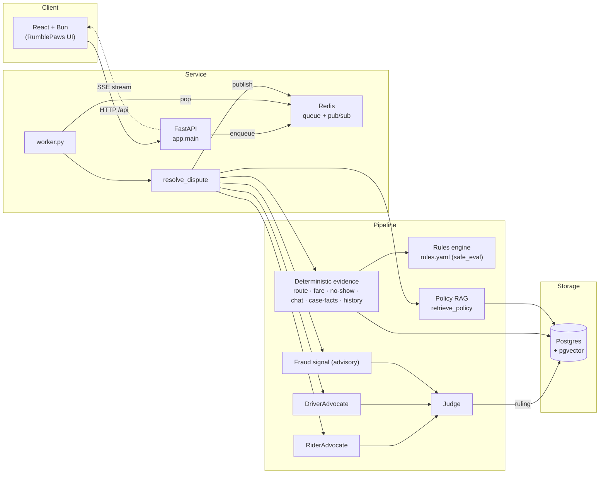

# RumblePaws — Multi-Agent Ride-Hailing Dispute Resolution

A hackathon MVP that resolves ride-hailing disputes end-to-end without human
intervention. Two advocates (rider and driver) investigate deterministic
evidence, a judge weighs their briefs against a policy knowledge base, and a
deterministic rules engine is the source of truth for every monetary amount —
**the LLM never does arithmetic**.

- **Backend:** Python 3.12 · FastAPI · SQLAlchemy 2 (async) · Postgres + pgvector · Redis · managed with `uv`
- **Frontend:** React + TypeScript · Bun · Vite

---

## Architecture



### Data flow (one dispute)

1. `resolve_dispute(dispute_id)` loads the dispute, its trip, and both accounts.
2. **Deterministic evidence** is computed once (route deviation, fare validation,
   no-show, chat analysis, case facts, account history) and handed to both
   advocates — no LLM is involved in any number.
3. **Policy RAG** retrieves the top relevant policy sections (category-filtered,
   ≤4 chunks, minimum similarity cutoff).
4. The **rules engine** evaluates `rules.yaml` against the evidence to produce the
   authoritative outcome + refund amount.
5. `RiderAdvocate` and `DriverAdvocate` produce case briefs citing evidence ids;
   a **fraud signal** is computed in parallel (advisory only).
6. A **rebuttal round** runs (configurable via `REBUTTAL_ENABLED`).
7. The **Judge** reconciles the LLM ruling against the rule result (the rule
   amount is a ceiling), validates citations, computes confidence, decides
   escalation, and persists the ruling.

---

## Agent flow

| Step | Actor | Responsibility |
|---|---|---|
| Evidence gathering | Pipeline | Run deterministic analyzers once up front; share with both advocates. |
| Opening arguments | RiderAdvocate / DriverAdvocate | Produce a `CaseBrief` (position, claims, evidence + policy citations, weaknesses). |
| Fraud check | Fraud signal | Rule-based abuse-risk scoring; **advisory only** — never auto-denies. |
| Rebuttal round | RiderAdvocate / DriverAdvocate | Re-argue against the opponent's brief. |
| Judge deliberation | Judge | Reconcile rules + LLM, validate citations, score confidence. |
| Final verdict | Judge | Persist `Ruling`; escalate to human review when required. |

Every inter-agent message is saved to `agent_messages` and published to Redis so
the UI streams it live over SSE.

---

## Rules engine

`backend/rules/rules.yaml` is a list of deterministic rules, evaluated in order
(first match wins). Each rule has a `category`, a `citation` to a policy section,
a safe boolean `conditions` expression, and an `amount` expression.

- Expressions are evaluated by a small **safe evaluator** (`app/rules/evaluator.py`)
  — arithmetic, comparison, boolean operators and `min/max/abs/round` only, never
  Python `eval()`.
- Facts referenced by rules come from two evidence layers:
  - **raw-case facts** (`app/evidence/case_facts.py`) — authoritative fields from
    the official sample cases (`traffic_justified`, `deviation_notified`,
    `contact_obligation_met`, `surge_increased`, `rider_notified`, …).
  - **GPS/fare evidence** (`route.py`, `fare.py`, `noshow.py`, `chat.py`).
- The rule result is the **source of truth for the amount**. The LLM may reduce a
  refund but never exceed it (see the reconciliation below).

## RAG (policy retrieval)

1. `backend/policies/*.md` are split into **section-level chunks** on `## ` headings.
2. Each chunk is embedded (local `fastembed` `BAAI/bge-small-en-v1.5` by default,
   or the Gemini embeddings API if `EMBEDDING_API_KEY` is set) into `policy_chunks`
   as a pgvector vector.
3. `retrieve_policy` embeds the claim, restricts the search to the dispute's
   category, orders by cosine distance, applies `k ≤ 4` and a minimum similarity
   cutoff, and returns `{source, section, text, similarity}` chunks.
4. Results are cached per `(category, normalized query)` for the dispute so both
   advocates share one retrieval.

The Judge prompt receives only the policy sections cited by the advocates plus the
top-2 retrieved chunks (not the whole retrieval set).

---

## Confidence formula

Deterministic — not LLM self-reported (`app/agents/judge.py`):

```
confidence = 0.35 · agreement
           + 0.30 · evidence_strength
           + 0.20 · citation_validity
           + 0.15 · history_risk
```

- `agreement` — 1.0 when LLM and rules agree on the outcome, else 0.3.
- `evidence_strength` — mean strength of the cited evidence items.
- `citation_validity` — fraction of cited evidence ids that actually exist.
- `history_risk` — max abuse-risk score across rider and driver.

A **fraud penalty** (`fraud_penalty_weight · risk`) is then subtracted when the
favored side's risk is at/above the threshold; the result is clamped to `[0, 1]`.

### Refund reconciliation

```
final_amount = min(rule_amount, max(llm_amount, 0.0))
```

The rules engine sets the ceiling; the LLM may only reduce the refund.

---

## Responsible AI

- **The LLM never does math.** Every number (distance, deviation, fare, refund,
  confidence) is computed by deterministic Python or the rules engine.
- **Demographics change tone only.** `age_band`/`tone` affect the wording of the
  rider/driver explanations, never the outcome or amount.
- **Citations are validated.** The Judge strips hallucinated evidence ids; a claim
  with no valid citation is dropped.
- **Safety always escalates.** `safety_incident` (and safety keywords anywhere in
  a claim) force human review regardless of category or confidence.
- **Fraud never auto-denies.** The fraud signal is advisory; it only lowers
  confidence and raises the escalation bar, never the outcome.

---

## Setup (Windows / PowerShell)

Prerequisites: **Docker Desktop**, **Python 3.12+**, **uv**, **Bun**.

```powershell
# 1. Start Postgres + Redis (repo root)
docker compose up -d

# 2. Create env file and set LLM_API_KEY
Copy-Item .env.example backend\.env

# 3. Install backend dependencies
cd backend
uv sync

# 4. Apply migrations (creates tables + pgvector extension)
uv run alembic upgrade head

# 5. Import the official sample cases (DISP-001/002/003)
uv run python scripts/import_cases.py

# 6. Ingest policy documents into pgvector
uv run python scripts/ingest_policies.py

# (optional) seed synthetic trips/disputes for the local demo
uv run python scripts/seed.py
```

Run the API and the queue worker (two terminals):

```powershell
# Terminal A — API (backend/)
uv run uvicorn app.main:app --reload

# Terminal B — worker that drains the resolution queue (backend/)
uv run python scripts/worker.py
```

Run the frontend (third terminal):

```powershell
cd frontend
bun install
bun run dev   # http://localhost:5173
```

API docs: `http://localhost:8000/docs`. Health: `http://localhost:8000/health`.

### Demo script

Resolves one route-deviation and one no-show dispute and prints the ruling and
agent timeline:

```powershell
cd backend
uv run python scripts/demo.py
```

Other useful scripts: `scripts/resolve_all.py`, `scripts/evaluate.py`,
`scripts/generate_variants.py`, `scripts/check_llm.py`.

---

## Evaluation — "synthetic variants of organizer samples"

Final run: `LLM_MOCK=false`, `EVAL_CONCURRENCY=3`, `REBUTTAL_ENABLED=true`, on
**3 golden cases (DISP-\*) + 20 variants (VAR-\*)**. Full per-dispute output is
saved to `backend/data/eval/report.json` and `report.md`.

| metric | value |
|---|---|
| disputes resolved | 23 |
| degraded (excluded from metrics) | 3 — `VAR-R02`, `VAR-N03`, `VAR-N06` |
| non-degraded | 20 |
| outcome accuracy | **20/20 (100.0%)** |
| refund error (mean \|actual − expected\|) | **0.000** (n=20) |
| escalation precision | **8/12 (66.7%)** |
| escalation recall | **8/8 (100.0%)** |
| mean time per dispute | **47.42s** (median 51.92s) |

Per-section accuracy: **Section 1 (route) 8/8 · Section 2 (no-show) 5/5 ·
Section 3 (surge) 7/7** (all 100%).

Models: advocate/judge/tools = `gemini-3.5-flash-lite`;
embeddings = `fastembed/BAAI/bge-small-en-v1.5` (dim 384).

Escalation precision is 66.7% because the ground-truth `escalate` flag only covers
deterministic triggers (safety, >$50, >2 km deviation, fraud flag); the system
additionally escalates on low confidence (§6.1), which the ground truth counts as
false positives — not rule errors.

---

## Known limits

- **LLM rate limits** (`429`) can degrade disputes under load; the harness retries
  with exponential backoff and reports degraded cases separately.
- **No real authentication** — the persona switcher (rider/driver/ops) is a demo
  stand-in; `filed_by` is derived from the trip.
- **User attachments are advisory** — image/PDF analysis is best-effort via the
  LLM, marked "unverified", strength capped at 0.5, and can never change the
  ruling.
- **Route/traffic evidence is simulated** — there is no live traffic API; the
  traffic justification is a speed heuristic unless a raw case supplies it.
- **Policies are placeholders** aligned to a provided v2.1 document; several
  thresholds are simulation assumptions (noted in `app/config.py`).
- **Escalation ground truth** excludes confidence-based escalations, so precision
  is understated relative to the intended policy.

## Roadmap

- **Image analysis** — real image/PDF evidence understanding for
  `property_damage`/`safety_incident` (today only advisory attachments).
- **Policy editing with approval** — a UI to edit `policies/*.md` with a review/
  approval workflow before changes reach the RAG index.
- **Real auth** — per-account authentication to replace the demo persona switcher
  and derive `filed_by` from the signed-in user.
